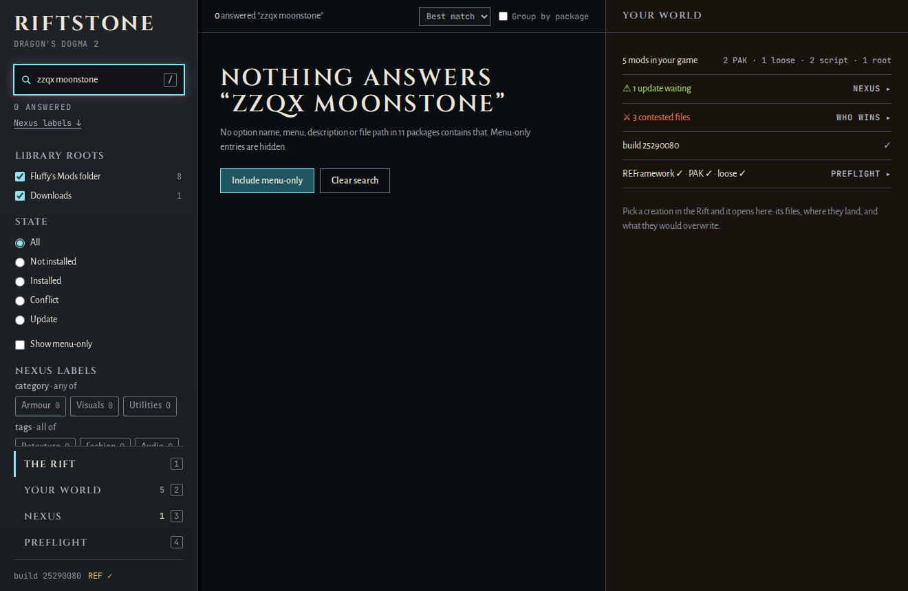
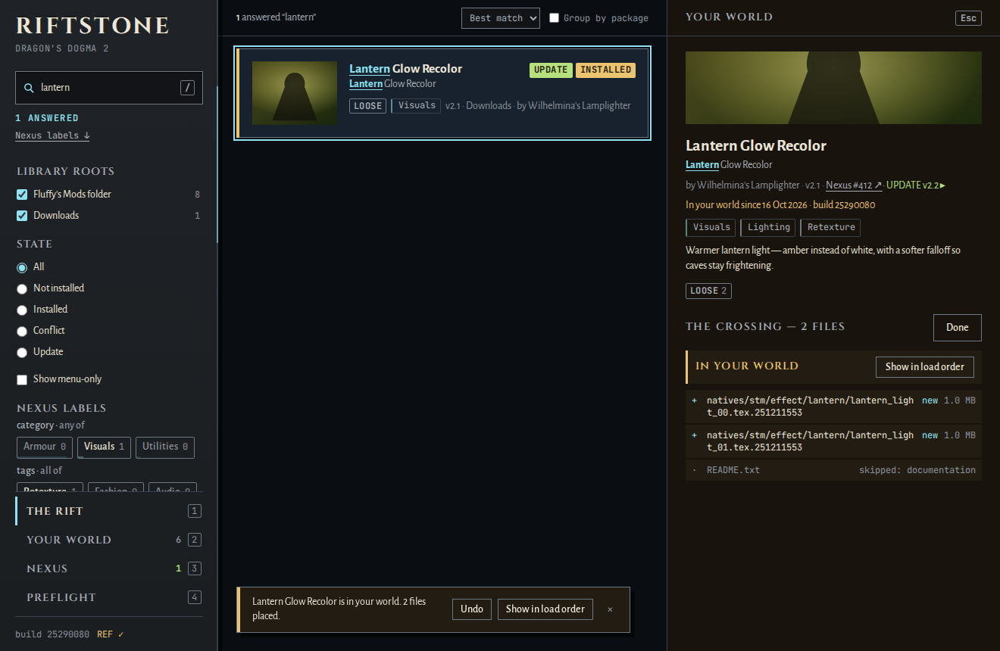

# The Riftstone

*Touch the stone and the Rift answers. Mods from other worlds wait inside; the stone shows you every one of them and pulls through the one you choose.*


The Riftstone is a Windows desktop mod manager for **Dragon's Dogma 2**, built because Fluffy Mod Manager searches mod titles and nothing else. It reads every download you have (zip, 7z, rar or a plain folder, nested as deep as the modder packed it) and searches all of it at once. It searches option names, descriptions, the menu trail a variant hides behind, and every file path inside the archives.

- Type `cloak_301` and get the variants that carry that mesh, even out of a collection with hundreds of options. Each result shows its menu trail and the folder it sits in.
- Install, uninstall and reorder the way the game loads mods after the September 2026 engine update. Pak mods go in REFramework's `pak_mods/` folder in name order (the last name wins). Loose `natives/` files beat paks. Scripts go in `reframework/`.
- It asks Nexus Mods whether a newer file of each download exists. The check is anonymous and needs no account. A 2026 download name carries the file's own id, so the stone checks that exact file.
- Filter by what Nexus calls a mod. Each linked mod's category and tags come home with that same check, at no extra request. Press categories in the stone (any of them) or tags (all of them), and every chip tells you how many answers it gives. The screenshots of mods Nexus flags adult, and of anything it has not labelled yet, can stay blurred until you hover. A download Nexus cannot recognise by its bytes (an unpacked folder, a repack) can be found by name, and you pick the right mod from up to five.

<p>
  
  
</p>

*Every name in these frames is invented. They were shot from the window's mock backend (`npm run dev`), never from a real library.*

## The promises

- **Your library is read-only.** Nothing writes, renames or deletes inside a library folder.
- **Vanilla is sacred.** `DD2.exe`, the game's own `re_chunk_000.pak*`, `dlc/` and their kin are refused outright. Any other file a mod would overwrite is backed up first and put back on uninstall.
- **A write-ahead journal.** Every install records what it means to do before the first byte moves. If one is cut short by a crash or a power cut, it is rolled back at the next launch.
- **Fluffy is a neighbour.** Its `installed.ini` and files are read and can be adopted into the journal. The stone never writes them, and it never deletes a Fluffy file it has not adopted.
- **Nexus is optional.** Everything works offline. An optional personal API key, for account extras only, lives in Windows Credential Manager and never in a file.

## Development

```sh
npm install
npm run dev            # the window in a browser on the mock backend (?mock=empty|nogame|scanning|…)
npm run tauri dev      # the real app (WSL bench: set RIFTSTONE_GAME_ROOT / RIFTSTONE_FLUFFY_ROOT / RIFTSTONE_DATA_HOME)
npm run tauri build    # on Windows: target/release/riftstone.exe and an unsigned NSIS installer
```

The lab journal is in [`CLAUDE.md`](CLAUDE.md): architecture contract, crate map, load rules and gates. So is the contract every crate was built to ([`docs/BUILD-SPEC.md`](docs/BUILD-SPEC.md)) and the window contract ([`docs/WINDOW-CONTRACT.md`](docs/WINDOW-CONTRACT.md)).

The git log and the journals are the laboratory's working diary, kept as they were written. In them, "the investor" is the player the stone was built for. Everyone else named there (the main session, its lenses and fixers, the Chaos Monkey, the Artisan, the Illusionist) is an AI agent that built or reviewed it.

Part of the [Zmuuzn laboratory](https://github.com/Goosterhof/zmuuzn). Not affiliated with Capcom, Nexus Mods or the authors of Fluffy Mod Manager and REFramework. Dragon's Dogma 2 is Capcom's; the stone only reads and places your own downloads in your own game folder.
