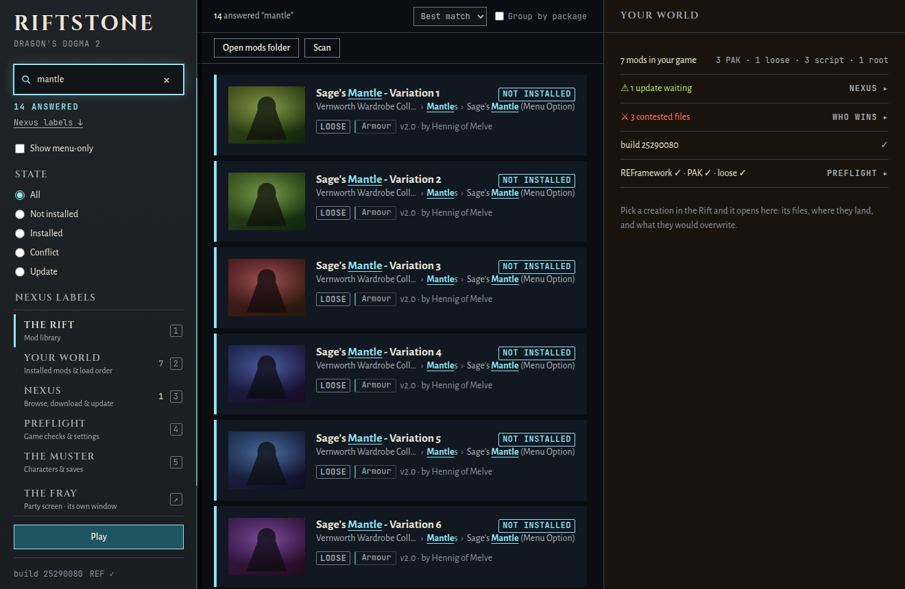
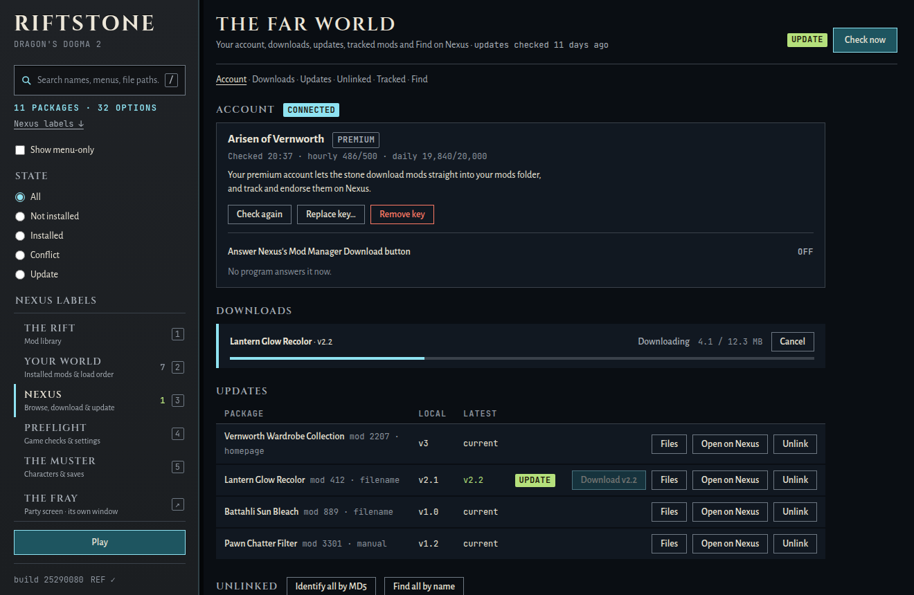
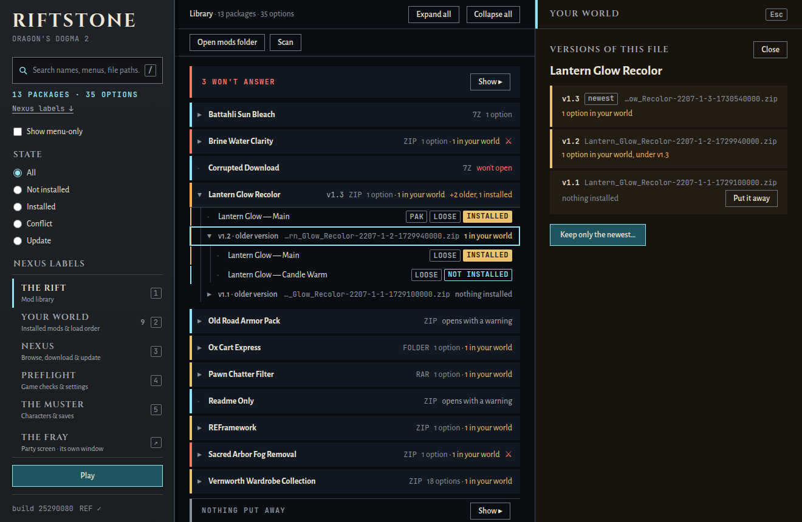
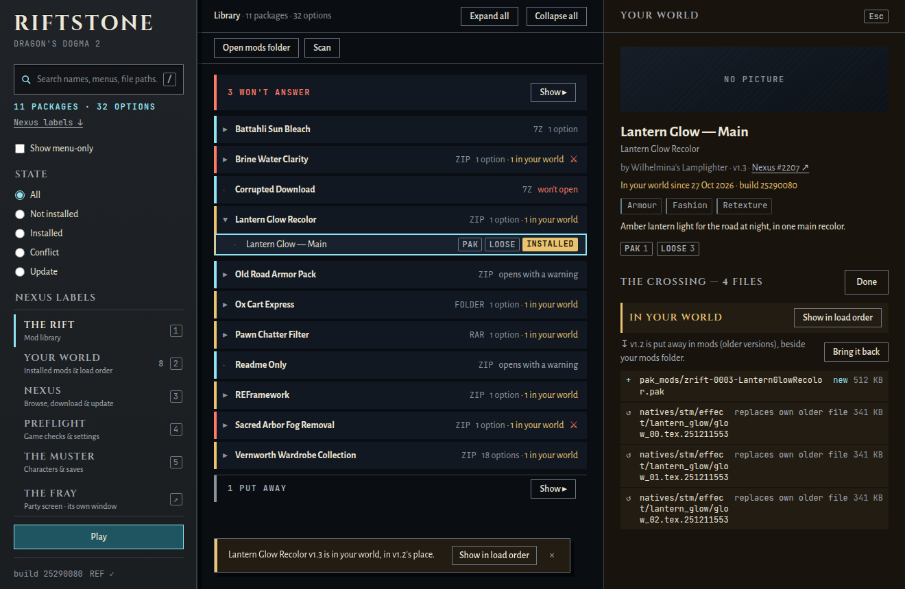
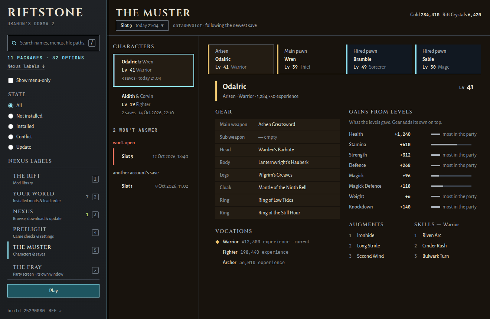
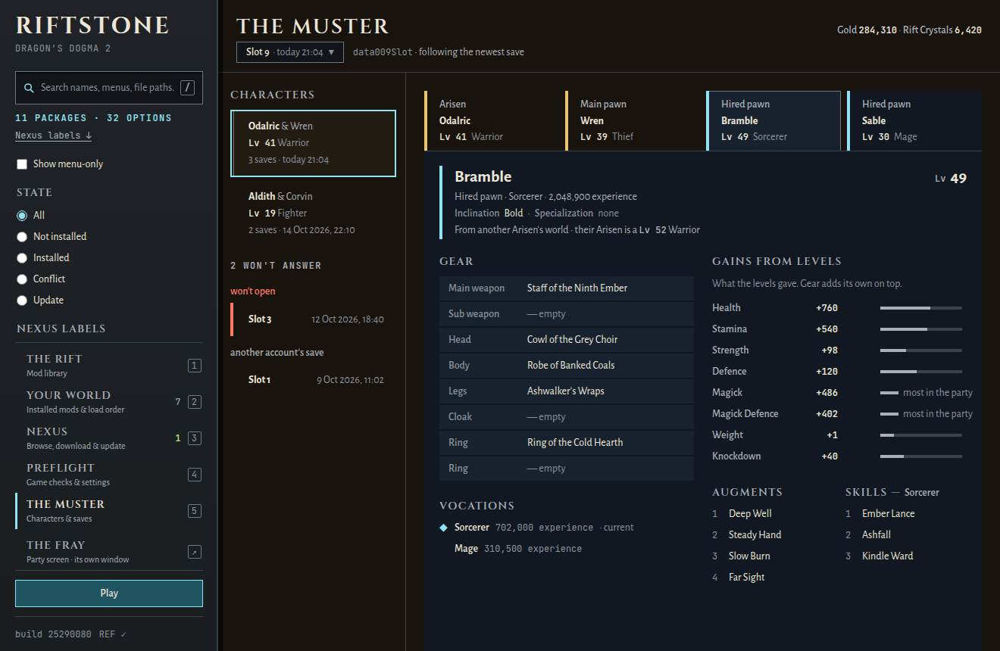
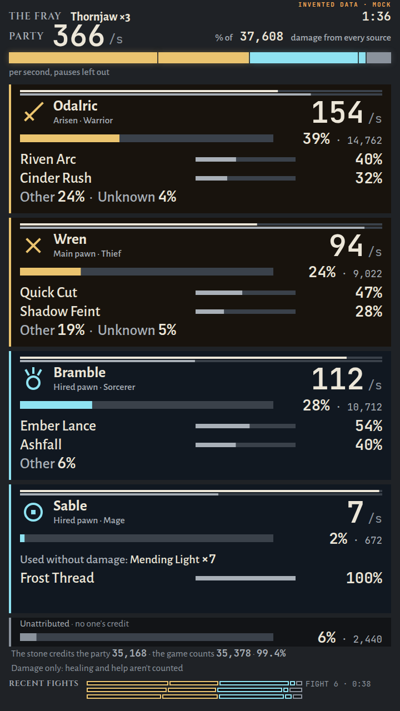
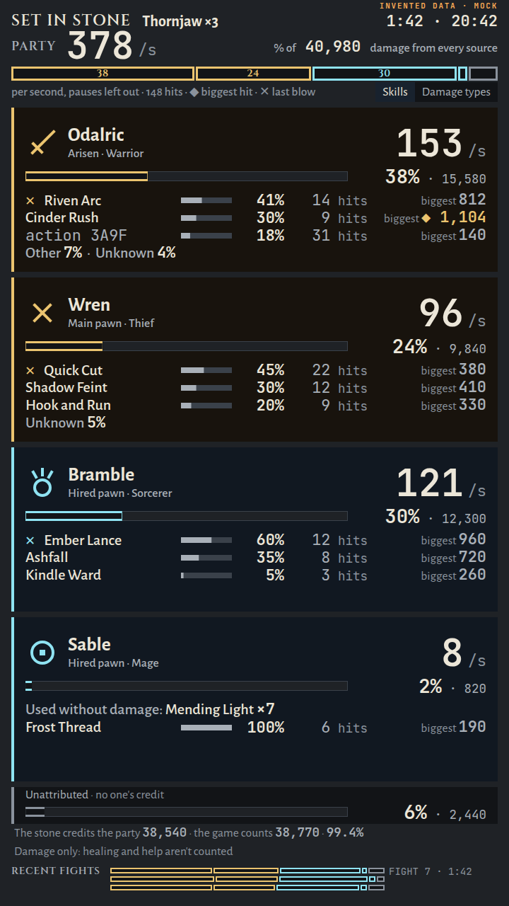

# The Riftstone

*Touch the stone and the Rift answers. Mods from other worlds wait inside; the stone shows you every one of them and pulls through the one you choose.*


The Riftstone is a Windows desktop mod manager for **Dragon's Dogma 2**. Its library is one folder: the `mods` folder beside the installed `riftstone.exe`. Put a mod there (zip, 7z, rar or a plain folder, nested as deep as the modder packed it) and the stone reads all of it: option names, descriptions, the menu trail a variant hides behind, and every file path inside the archives.

- Open the stone and the Rift shows your packages as a tree. Open one and go deeper, menu by menu, down to the variant you want.
- Type `cloak_301` and get the variants that carry that mesh, even out of a collection with hundreds of options. A search shows every match, each with its menu trail.
- Install, uninstall and reorder the way the game loads mods after the September 2026 engine update. Pak mods go in REFramework's `pak_mods/` folder in name order (the last name wins). Loose `natives/` files beat paks. Scripts go in `reframework/`.
- Press Play and the stone starts the game (through Steam when Steam found it), and knows when it is running.
- It asks Nexus Mods whether a newer file of each download exists. The check is anonymous and needs no account. A 2026 download name carries the file's own id, so the stone checks that exact file.
- Filter by what Nexus calls a mod. Each linked mod's category and tags come home with that same check. Press categories in the stone (any of them) or tags (all of them), and every chip tells you how many answers it gives. The screenshots of mods Nexus flags adult, and of anything it has not labelled yet, can stay blurred until you hover. A download Nexus cannot recognise by its bytes (an unpacked folder, a repack) can be found by name, and you pick the right mod from up to five.
- Download an update and the stone knows it is the same mod's newer version, because Nexus says so (the same mod and file group), never because two names look alike. The Rift and the update list show the mod once, the newest version leading and the older ones inside it. Installing the newer version takes the older one's place in one step, keeping its place in the load order, and puts the older archive away in a folder beside your mods folder, `mods (older versions)`, from where one press brings it back. *Keep only the newest* cleans up versions installed one over another.
- Open THE MUSTER and the stone reads your party from your own save slots, the way a Riftstone in the game shows you a pawn: the Arisen, the main pawn and the hired pawns, each with level, vocation, the experience in every vocation, the stats their levels gave, everything they wear by slot, the augments and skills set for the vocation in use, a pawn's inclination and specialization, and your gold and Rift Crystals. It opens on the character you picked last (your Arisen with their main pawn), at their newest save, and keeps their other saves in a menu. The names come from your own game install, read where they live. Keep the stone open while you play and it notices when the game saves, follows the character into the newer save, and marks what changed.
- Open THE FRAY and the stone puts a party screen in its own window, made to stand on a second monitor while you play: each member's damage per second and share of the fight, the skills it came from, named from your own game install, and when the fight settles, its record with hits, biggest hits, the last blow and the seven damage types, beside the last five fights. Its numbers come from a small read-only REFramework script that writes what the game reports about each hit. The stone checks itself against the game's own count of the party's damage and says how close it came.
- Give it your personal Nexus key and it shows your account, tracks and endorses mods, and downloads files straight into the mods folder: a newer version from the update list, any file of a mod, or a mod you found by browsing Nexus from the stone. A premium account downloads in the stone. A free account presses Nexus's own Mod Manager Download button, which reaches the stone once you turn on its link handler. A download lands in the mods folder; installing it stays your choice.

<p>
  
  
</p>
<p>
  
  
</p>

<p>
  
  
</p>

<p>
  
  
</p>

<p>
  
  
</p>

*Every name in these frames is invented. They were shot from the window's mock backend (`npm run dev`), never from a real library.*

## The promises

- **The mods folder is yours.** The stone never changes, renames or deletes anything you put in it. The one thing it adds is a download you asked for. While it arrives it sits under a hidden partial name, which the stone removes if the download fails or you cancel it, and it takes its real name only once it is whole and checked, never over a file that is already there. The one thing it moves is an older version of a file whose newer version you installed: whole, into `mods (older versions)` beside your mods folder, only once that install is done (or when you press *Put it away*), and back again when you press *Bring it back*. Nothing is copied, deleted or written over on the way.
- **Vanilla is sacred.** `DD2.exe`, the game's own `re_chunk_000.pak*`, `dlc/` and their kin are refused outright. Any other file a mod would overwrite is backed up first and put back on uninstall.
- **A write-ahead journal.** Every install records what it means to do before the first byte moves. If one is cut short by a crash or a power cut, it is rolled back at the next launch.
- **Nexus is optional.** Searching, installing, update checks, labels and browsing Nexus work without an account. Only the key's extras need one: your account, downloads, tracking and endorsing. A personal API key lives in Windows Credential Manager and never in a file; the stone never shows it, logs it or sends it anywhere but Nexus.
- **The link handler gives back what it took.** It is off until you turn it on. Turning it on remembers what answered Nexus's Mod Manager Download button before; turning it off puts that back, and the stone touches nothing it did not write. If that memory cannot be read, the stone changes nothing and says so rather than guess.
- **Your saves are only read.** The stone reads a save slot into memory to show its party, and that is all: it never writes, renames, copies or sends a save, and keeps no decrypted copy anywhere. The names of what your party carries come from your own game's files, read in place.
- **Uninstalling the stone leaves your mods.** The uninstaller removes only the files it installed. Before it removes any, it asks the stone to give the Mod Manager Download links back, just as turning the handler off would; where the stone cannot put them back, it removes the nxm entry it had claimed, so Windows never sends a link to a program that is gone. Installing a newer version uninstalls the old one first by default, so turn the handler on again after an upgrade. The uninstaller's *Delete the application data* box, unticked unless you tick it, also removes the stone's journal and backups, so uninstall your mods from the stone before you tick it.

## Development

```sh
npm install
npm run dev            # the window in a browser on the mock backend (?mock=empty|nogame|scanning|premium|running|…)
npm run tauri dev      # the real app (WSL bench: set RIFTSTONE_GAME_ROOT / RIFTSTONE_MODS_DIR / RIFTSTONE_DATA_HOME)
npm run tauri build    # on Windows: target/release/riftstone.exe and an unsigned NSIS installer
```

The lab journal is in [`CLAUDE.md`](CLAUDE.md): architecture contract, crate map, load rules and gates. Beside it are the contract every crate was built to ([`docs/BUILD-SPEC.md`](docs/BUILD-SPEC.md)) and the window contract ([`docs/WINDOW-CONTRACT.md`](docs/WINDOW-CONTRACT.md)).

The git log and the journals are the laboratory's working diary, kept as they were written. In them, "the investor" is the player the stone was built for. Everyone else named there (the main session, its lenses and fixers, the Chaos Monkey, the Artisan, the Illusionist) is an AI agent that built or reviewed it.

Part of the [Zmuuzn laboratory](https://github.com/Goosterhof/zmuuzn). Not affiliated with Capcom, Nexus Mods or the authors of REFramework. Dragon's Dogma 2 is Capcom's; the stone only reads and places your own downloads in your own game folder, and reads your own saves and your own copy of the game's text. Nothing of the game's ships with the stone.
